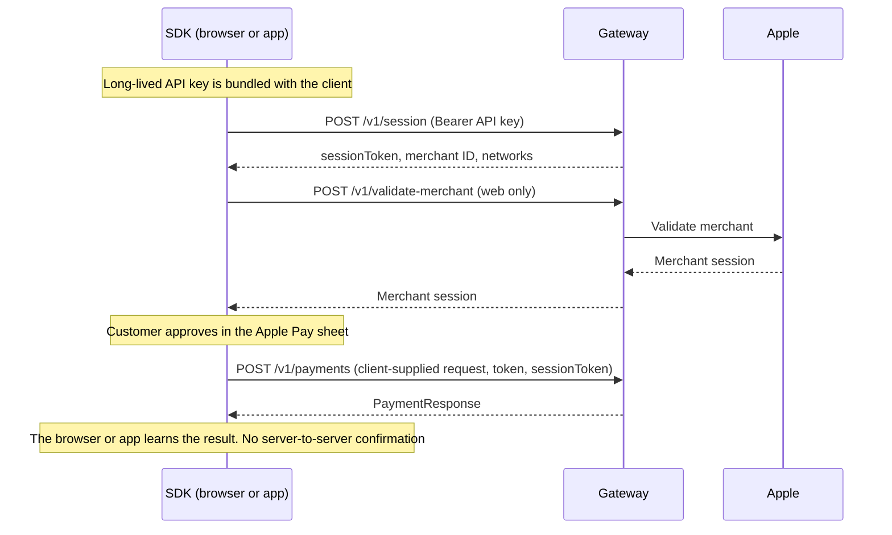
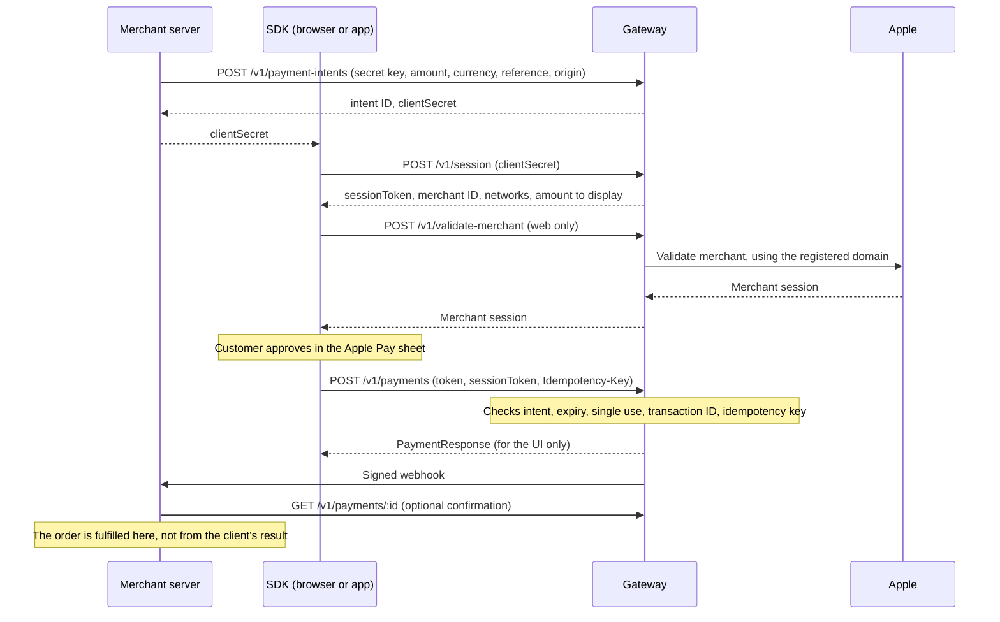

# Security Architecture

This document describes how Gateway Pay SDK handles payment authorization today, the architecture it is moving to, and where trust changes hands. Threats and mitigations are in [THREAT-MODEL.md](THREAT-MODEL.md). Controls a real gateway must provide are in [GATEWAY-REQUIREMENTS.md](GATEWAY-REQUIREMENTS.md).

**Status:** the [current architecture](#current-architecture) is what the code does now. The [target architecture](#target-architecture) is planned for v0.1 and is not implemented yet.

## Scope

In scope:
- `packages/core`, `packages/pay-web`, `packages/pay-react-native`, `packages/pay-ios`
- A reference mock gateway, planned as `apps/mock-gateway`
- Example apps, CI and the release process

Out of scope:
- A production gateway, including Apple Pay token decryption and card processing
- Apple's infrastructure and the security of the customer's device
- PCI DSS compliance. The SDKs never see card numbers, but this project makes no compliance claim.

## Components

| Component | Runs on | Trust level | Holds |
|---|---|---|---|
| Web SDK | Merchant page in the customer's browser | Untrusted | Today: API key, session token. Target: `clientSecret` |
| iOS and React Native SDKs | Customer's device | Untrusted | Same as above, plus the encrypted Apple Pay token in memory |
| Apple Pay sheet and Secure Element | Customer's device | Trusted (Apple) | Card credentials |
| Merchant server | Merchant infrastructure | Trusted by the merchant | Target: merchant secret key, webhook secret |
| Gateway | Gateway infrastructure | Trusted | Merchant records, Apple Pay decryption keys |
| Apple Pay servers | Apple | Trusted (Apple) | Merchant validation |

The merchant page and app run on hardware the customer controls. Anything they hold can be read, and any request they send can be altered.

## Current architecture

Weaknesses in this design:
- **The client holds a long-lived credential.** Anyone can extract the key from the bundle.
- **The client states the amount.** Nothing in the SDK contract ties a payment to an order that a merchant server created.
- **The result ends at the client.** A merchant that fulfils orders from this result is trusting a device it doesn't control.

## Target architecture

### Security invariants

1. No long-lived credential ships in a client.
2. Amount, currency and reference are fixed by the merchant server when the intent is created. The client can't change them.
3. A `clientSecret` is short-lived, single-use, and bound to one intent and its allowed origin.
4. The SDK result only drives the UI. Fulfilment relies on a signed webhook or a server-side lookup.
5. An Apple Pay token can be accepted at most once.
6. A retry repeats the same request with the same idempotency key. The same key with a different payload is rejected.
7. Credentials are only sent over HTTPS. Plain HTTP is allowed only for loopback addresses during development.
8. Tokens and secrets are never logged or persisted by the SDKs.
9. Client-side validation helps developers, but it is not a security control. The gateway validates everything again.

## Trust boundaries

| ID | Boundary | What crosses it | Main concern |
|---|---|---|---|
| B1 | Customer device ↔ merchant page or app | Payment approval, encrypted token | The Apple Pay sheet is trusted; the page around it is not |
| B2 | Merchant page or app ↔ gateway | `clientSecret`, session token, Apple Pay token, payment result | The client is untrusted, so the gateway must verify everything it sends |
| B3 | Merchant server ↔ gateway | Secret key, intents, webhooks | Key protection and webhook authenticity |
| B4 | Gateway ↔ Apple | Merchant validation | Only Apple hosts may be contacted, using the merchant's identity certificate |
| B5 | Third-party scripts ↔ merchant page | Script access to the page and SDK state | Any script on the page can read what the SDK holds |
| B6 | CI and release pipeline ↔ published code | Source, dependencies, release artifacts | Secrets, dependency compromise, tampered releases |

## Data handling

| Data | Sensitivity | Where it may exist | Rules |
|---|---|---|---|
| Merchant secret key | Critical | Merchant server, gateway | Never in a client, repository or log |
| `clientSecret` | High, short-lived | Merchant server, client memory, gateway | Never persisted or logged |
| Session token | High, short-lived | Client memory, gateway | Never persisted or logged |
| Apple Pay token | High | Client memory, gateway | Sent once over TLS, then discarded by the client. Never logged |
| Webhook secret | Critical | Merchant server, gateway | Rotatable. Never in a client |
| Payment result | Medium | Client, merchant server, gateway | Client copy is for display only |
| Billing or shipping contact | Personal data | Apple Pay sheet, merchant server, gateway | Request only what's needed. Never logged |
| Request ID | Low | Anywhere | Safe for logs and support |

## Key design decisions

- [ADR 0001: Payment intents instead of client API keys](adr/0001-payment-intents.md)
- [ADR 0002: No certificate pinning in v0.1](adr/0002-no-certificate-pinning.md)
- [ADR 0003: Mock gateway scope](adr/0003-mock-gateway-scope.md)
